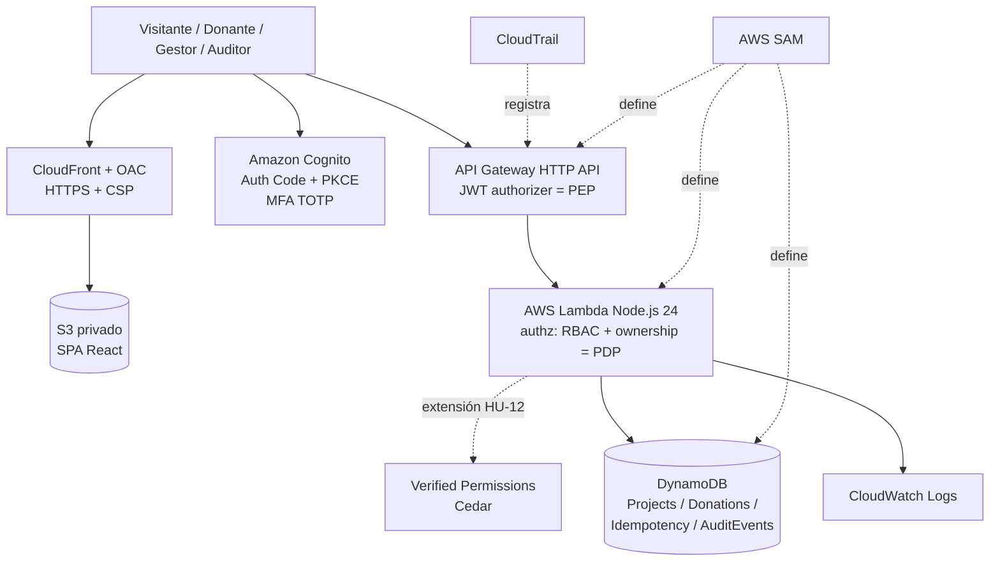

# Diseño técnico — Plataforma de Donaciones Seguras (2026)

**Curso:** Tópicos Avanzados en Ingeniería de Software — EPIS, UNSA
**Versión:** 2.0 | **Fecha:** 2026-11-02 | **Arquitectura:** cloud-native serverless con modelo de seguridad Zero Trust
**Duración:** 1 semana calendario | **Equipo:** 4 a 5 integrantes | **Cuenta:** AWS Free plan
**Trazabilidad:** [requirements.md](./requirements.md)

## 1. Decisiones arquitectónicas

- **AD-01 — Zero Trust como modelo de seguridad:** identidad y permisos verificados en cada solicitud; ninguna confianza por ubicación de red; privilegio mínimo para personas y cargas de trabajo; asumir brecha. ZTA no es un estilo de descomposición funcional.
- **AD-02 — Serverless modular:** SPA React estática y API Node.js en Lambda; módulos `projects`, `donations`, `authz`, `audit` en un único repositorio, sin imponer microservicios.
- **AD-03 — Transacciones simuladas:** donaciones como estados simulados; **no procesar pagos reales**. Una versión productiva requeriría un PSP con tokenización, webhooks firmados, conciliación, antifraude y revisión legal.
- **AD-04 — Backend autoritativo:** permisos, importes y transiciones se validan solo en servidor; dinero en enteros (céntimos de PEN).
- **AD-05 — Idempotencia atómica:** reserva de clave y creación de donación en un único `TransactWriteItems` condicionado.
- **AD-06 — Cuenta AWS Free plan:** una cuenta por equipo, una sola región (recomendado `us-east-1`), usuarios IAM con MFA por integrante. IAM Identity Center, Organizations, Verified Access, GuardDuty y Security Hub **no** están disponibles en el Free plan y quedan fuera del diseño.
- **AD-07 — Tokens de vida corta:** access token ≤ 15 min y refresh token revocable, porque el JWT authorizer no consulta revocaciones (ver §6.3).
- **AD-08 — Autorización en dos niveles:** MVP con RBAC + ownership en el módulo `authz`; extensión HU-12 con Amazon Verified Permissions (Cedar) como Policy Engine externo.

## 2. Stack tecnológico (verificado a 2026-11-02)

| Capa | Tecnología / versión de referencia | Uso y criterio |
|---|---|---|
| Lenguaje | TypeScript (fijar una versión compatible con typescript-eslint y Vitest; la última estable es 7.0.x) | Tipos compartidos frontend/backend |
| Frontend | React 19.3.x + React DOM | SPA accesible |
| Build | Vite 8.3.x | Desarrollo y compilación |
| Estilos | Tailwind CSS 4.x | Diseño responsive; **prohibido Bootstrap** |
| Componentes | Radix UI (opcional) + Lucide React | Accesibilidad sin kit completo |
| Enrutamiento | React Router 8.x | Rutas públicas y privadas (guard de UI solo para UX) |
| Formularios | React Hook Form 7.x + Zod 4.x | Validación UX; los esquemas Zod se reutilizan en backend |
| Datos remotos | TanStack Query 5.x | Caché, estados de carga/error |
| OIDC en SPA | oidc-client-ts (o AWS Amplify Auth) | Authorization Code + PKCE, tokens en memoria |
| Runtime backend | Node.js 24 (`nodejs24.x` en Lambda) | Runtime administrado vigente |
| API | Amazon API Gateway **HTTP API** | HTTPS, JWT authorizer, throttling por stage |
| Cómputo | AWS Lambda (una función por caso de uso o por módulo) | Roles IAM separados por función |
| Identidad | Amazon Cognito User Pool (plan Lite o Essentials) + grupos | OIDC, MFA TOTP, 10.000 MAU gratis |
| Autorización | Módulo `authz` (MVP); Amazon Verified Permissions + Cedar (extensión) | PDP embebido vs. externo |
| Persistencia | Amazon DynamoDB (on-demand) | Proyectos, donaciones, idempotencia y auditoría |
| Publicación | S3 privado + CloudFront con OAC + response headers policy | TLS, CSP y cabeceras de seguridad |
| Observabilidad | CloudWatch Logs (retención 14 días) + CloudTrail | Logs JSON y auditoría de infraestructura |
| IaC | AWS SAM / CloudFormation | Infraestructura reproducible y eliminable |
| Pruebas | Vitest 5.x + Testing Library + Bruno/Postman | Unitarias, UI, API negativas |
| Calidad | ESLint 10.x + Prettier 3.x + typecheck | Validación en CI |
| CI/CD | GitHub Actions | CI obligatorio; despliegue por OIDC opcional |
| Repositorio | GitHub | Ramas cortas, PR con revisión por pares |

**Versiones:** fijar versiones exactas en `package-lock.json`; ante incompatibilidades entre versiones mayores, el equipo elige la combinación estable y la justifica en el README. No se recomienda SSR ni Next.js.

## 3. Diagrama lógico



**Límites de confianza:** navegador (no confiable) → API Gateway (verifica JWT) → Lambda (autoriza rol, propietario y negocio) → DynamoDB (restringido por IAM por función). El frontend no contiene secretos ni credenciales AWS.

## 4. Componentes y contratos

### Módulos del backend

- `projects`: lectura pública de PUBLICADO; gestión solo GESTOR.
- `donations`: intención, simulación, historial por propietario y agregados.
- `authz`: deriva `sub` y `cognito:groups` del contexto del authorizer; aplica RBAC y ownership contra el recurso persistido.
- `audit`: eventos estructurados y correlación por `requestId`.

### Endpoints mínimos

| Método | Ruta | Acceso (scope / grupo) | Respuestas |
|---|---|---|---|
| GET | `/v1/projects` | Público | 200 |
| GET | `/v1/projects/{projectId}` | Público (solo PUBLICADO) | 200 / 404 |
| GET | `/v1/projects/{projectId}/stats` | Público | 200 / 404 |
| POST | `/v1/projects` | `api/projects.write` + GESTOR | 201 / 400 / 401 / 403 |
| PATCH | `/v1/projects/{projectId}/publish` | `api/projects.write` + GESTOR | 200 / 401 / 403 / 404 / 409 |
| POST | `/v1/donations` | `api/donations.write` + DONANTE | 201 / 400 / 401 / 403 / 404 / 409 |
| POST | `/v1/donations/{donationId}/simulate` | `api/donations.write` + DONANTE propietario; **solo stage `academic`** | 200 / 401 / 403 / 404 / 409 |
| GET | `/v1/donations/me` | `api/donations.read` + DONANTE | 200 / 401 |
| GET | `/v1/audit` | `api/audit.read` + AUDITOR (extensión) | 200 / 401 / 403 |

- Cabecera `Authorization: Bearer <access_token>`; las rutas protegidas declaran `AuthorizationScopes` en SAM, de modo que un ID token es rechazado.
- `POST /v1/donations` exige `Idempotency-Key` (UUID) y body `{ projectId, amountCents }`; `donorSub` se toma del contexto del authorizer.
- Errores con formato uniforme `{ code, message, requestId }`, sin detalles internos. Contrato en OpenAPI 3.1 (`docs/api.yaml`).

### Flujo de una donación académica

1. El usuario inicia sesión en Cognito (Authorization Code + PKCE); la SPA guarda los tokens en memoria.
2. La SPA envía la intención con access token, `amountCents` e `Idempotency-Key`.
3. API Gateway valida firma, emisor, expiración, `client_id` y scope; Lambda valida grupo, proyecto PUBLICADO, monto y clave.
4. Un `TransactWriteItems` crea el `IdempotencyRecord` (condición `attribute_not_exists`) y la donación `PENDIENTE_SIMULACION`.
5. El donante ejecuta la simulación desde una UI rotulada como prueba.
6. Un `TransactWriteItems` actualiza la donación (condición `status = PENDIENTE_SIMULACION` y `donorSub = :sub`) e incrementa `confirmedAmountCents` del proyecto si se confirma.
7. La UI muestra el resultado; se registran log JSON y `AuditEvent` sin datos sensibles.

## 5. Modelo de datos y consistencia

- `Projects`: PK `projectId`; GSI `status-createdAt` para el catálogo.
- `Donations`: PK `donationId`; GSI `donorSub-createdAt` para `GET /me`.
- `Idempotency`: PK `donorSub#createDonation#idempotencyKey`; atributos `payloadHash` (SHA-256 del body normalizado), `donationId`, `responseStatus`; TTL `expiresAt` (24 h).
- `AuditEvents`: PK `eventType`, SK `timestamp#eventId` para filtrar por tipo y fecha (HU-10).

**Reglas:** repetir clave con mismo `payloadHash` devuelve la respuesta almacenada; con hash distinto, 409. Si la transacción falla por condición (`TransactionCanceledException`), se responde 409 sin efectos parciales. Nunca representar dinero con `float`. Las lecturas que siguen a una escritura propia usan `ConsistentRead` cuando la consulta es por clave primaria.

## 6. Seguridad Zero Trust

### 6.1 Mapeo a NIST SP 800-207

| Componente NIST | Implementación en el laboratorio |
|---|---|
| Policy Enforcement Point (PEP) | API Gateway HTTP API con JWT authorizer y scopes; CloudFront para el frontend |
| Policy Engine (PE) | Módulo `authz` en Lambda (MVP) o Amazon Verified Permissions con Cedar (HU-12) |
| Policy Administrator (PA) | Cognito: emite, renueva y revoca tokens de sesión |
| Fuentes de información | Claims de Cognito, estado del recurso en DynamoDB, logs de CloudWatch y CloudTrail |

| Principio NIST SP 800-207 | Control | Evidencia |
|---|---|---|
| 1. Todo dato y servicio es un recurso | Cada endpoint y tabla con política explícita | Tabla de endpoints y políticas IAM |
| 2. Comunicación segura sin importar la red | HTTPS en CloudFront y API Gateway | CA-NF01.1 |
| 3. Acceso por sesión y por recurso | Access token ≤ 15 min, scopes por ruta, ownership por recurso | T09, T11, T13 |
| 4. Política dinámica | Decisión por solicitud con identidad, grupo, estado del recurso y stage | T03, T12 |
| 5. Monitorear la postura de los activos | **Parcial:** sin postura de dispositivo en el Free plan; CloudTrail y revisión de dependencias en CI | Limitación declarada |
| 6. Autenticación y autorización estrictas antes del acceso | JWT authorizer + `authz` + MFA en roles privilegiados | T02, T11, T14 |
| 7. Recolectar información para mejorar | Logs JSON, `AuditEvents`, CloudTrail | CA-NF07.2 |

### 6.2 Controles y verificaciones

| Riesgo/objetivo | Control | Evidencia |
|---|---|---|
| Acceso no autenticado | JWT authorizer | T02, T11 |
| Elevación vertical | RBAC por `cognito:groups` | T03 |
| Acceso horizontal / BOLA | Ownership por `sub` en cada acceso | T09, T12 |
| Robo de credenciales privilegiadas | MFA TOTP obligatorio para GESTOR y AUDITOR | T14 |
| Entrada manipulada | Zod en backend, `amountCents` entero acotado | T04 |
| Repetición / doble conteo | Idempotencia + transacciones condicionadas | T06–T08 |
| Uso de token robado | Vida corta + revocación de refresh token | T13 |
| Abuso / fuerza bruta | Throttling del stage HTTP API; protecciones de Cognito | Configuración SAM |
| XSS / robo de tokens | Tokens en memoria, CSP y cabeceras vía CloudFront | CA-NF11.1–2 |
| Acceso excesivo a datos | Rol IAM por función con acciones y tablas mínimas | T10, IAM Access Analyzer |
| Exposición de secretos | Sin secretos en SPA ni repo; secret scanning de GitHub | Repo limpio |
| Dependencias vulnerables | `npm audit` y Dependabot en CI | Reporte CI |
| Falta de trazabilidad | Logs JSON sanitizados + `AuditEvents` + CloudTrail | CA-NF07.2 |

### 6.3 Limitaciones conocidas (deben aparecer en el informe)

- **Revocación:** el JWT authorizer valida tokens localmente; un access token revocado sigue siendo válido hasta su expiración. Mitigación: vida corta (AD-07). Alternativa avanzada: Lambda authorizer con lista de revocación.
- **Sin postura de dispositivo ni evaluación continua de riesgo**, por no estar disponibles Verified Access ni Cognito Plus (threat protection) sin costo.
- **HTTP API no se integra con AWS WAF.** Si se requiere WAF, debe asociarse a CloudFront o usarse REST API; consume créditos.
- **Cuenta compartida por el equipo:** el aislamiento entre integrantes depende de IAM y de la disciplina del equipo.

## 7. Cuenta AWS Free plan: configuración y costos

**Servicios usados y disponibilidad en el Free plan** (verificar en la lista oficial antes de desplegar): Lambda, API Gateway, DynamoDB, Cognito, S3, CloudFront, CloudWatch, CloudFormation/SAM, IAM, CloudTrail, Verified Permissions y AWS Budgets están incluidos.

**Configuración inicial (día 1):**
1. Un integrante crea la cuenta Free plan (requiere correo, teléfono y posiblemente tarjeta; solo se cobra si se pasa a Paid plan).
2. Activar MFA en el usuario root y dejar de usarlo.
3. Crear un usuario IAM por integrante con MFA y permisos acordes a su función; no crear llaves de acceso de larga duración. Para despliegues, usar AWS CloudShell o credenciales temporales.
4. Fijar una sola región y crear una alerta en AWS Budgets.
5. Opcional: rol IAM para GitHub Actions con OIDC, limitado al repositorio y a la rama principal.

**Costos:** el Free plan no genera cargos; el consumo fuera de los límites gratuitos se descuenta de los créditos (hasta 200 USD, 6 meses). Este diseño a escala de laboratorio consume una fracción mínima. Evitar MFA por SMS, Cognito Plus, WAF y servicios fuera de la lista. La cuenta se cierra a los 6 meses o al agotar los créditos.

**Limpieza:** `sam delete`, vaciar y eliminar buckets S3, eliminar el user pool si no se borró con la pila y verificar en el Tag Editor / Resource Explorer que no queden recursos.

## 8. Estructura propuesta de GitHub

```text
secure-donations-2026/
├── frontend/                  # React + Vite + Tailwind
│   ├── src/pages/
│   ├── src/components/
│   ├── src/auth/              # oidc-client-ts, tokens en memoria
│   └── src/services/
├── backend/
│   ├── src/projects/
│   ├── src/donations/
│   ├── src/authz/
│   ├── src/audit/
│   ├── src/shared/            # esquemas Zod, errores, logger
│   └── test/
├── infra/template.yaml        # AWS SAM (stage academic)
├── policies/                  # Cedar (extensión HU-12)
├── docs/api.yaml              # OpenAPI 3.1
├── docs/threat-model.md       # STRIDE resumido + mapeo NIST
├── evidence/                  # capturas sanitizadas, reportes de pruebas
├── .github/workflows/ci.yml
├── requirements.md
├── design.md
├── README.md
└── AI_USAGE.md
```

Reglas: rama `main` protegida, PR con al menos una revisión de otro integrante, commits significativos y nada de llaves, tokens ni datos reales.

## 9. Plan de trabajo (1 semana calendario, 4–5 integrantes)

**Roles sugeridos:** (1) líder técnico y DevOps (SAM, CI, cuenta); (2) identidad y seguridad (Cognito, MFA, authz, threat model); (3) backend (donaciones, idempotencia, DynamoDB); (4) frontend (React, accesibilidad, OIDC); (5) QA y documentación (pruebas T01–T14, evidencias, informe). Con 4 integrantes, QA y documentación se reparte entre todos.

| Día | Objetivo | Entregable verificable |
|---|---|---|
| 1 | Análisis, threat model, cuenta Free plan, repositorio y CI | Cuenta segura, `main` protegida, CI en verde con proyecto vacío |
| 2 | Infraestructura base y autenticación | SAM con Cognito, API y DynamoDB desplegados; login PKCE funcionando; T02 y T11 |
| 3 | Proyectos y catálogo | HU-01, HU-02, HU-08, HU-09; T01, T03 |
| 4 | Donaciones e idempotencia | HU-05, HU-07; T04–T07, T09, T12 |
| 5 | Simulación, concurrencia y MFA | HU-06, HU-11; T08, T13, T14; CloudFront + CSP |
| 6 | Endurecimiento y extensiones | Revisión IAM (T10), logs, accesibilidad, rendimiento; HU-10/HU-12 opcional |
| 7 | Cierre | README, informe, mapeo NIST, `AI_USAGE.md`, demo y limpieza planificada |

**Esfuerzo estimado:** 8–12 horas por integrante en la semana. Hito de control sugerido al final del día 3 (demo de login y catálogo).

**Pruebas:** unitarias de reglas de negocio (Vitest), componentes UI (Testing Library), integración de endpoints contra el stage desplegado (Bruno/Postman, colección versionada) y pruebas negativas de seguridad. Debe demostrarse que la UI por sí sola **no** implementa autorización (llamadas directas al API con tokens de otros roles).

## 10. Uso de asistentes y agentes de código

Los equipos **pueden usar Claude Code, OpenAI Codex, Gemini u otros asistentes** para planificación, scaffolding, programación, refactorización, pruebas y documentación, siempre con revisión humana.

**Reglas:**
- Todo cambio generado por IA entra por PR y es revisado por un integrante distinto de quien lo generó.
- No se comparten con los asistentes credenciales AWS, tokens, contenidos de `.env` ni datos personales reales; los agentes con acceso a terminal no deben ejecutar despliegues ni comandos sobre la cuenta AWS sin supervisión.
- Los controles de seguridad (authz, idempotencia, políticas IAM) deben tener pruebas escritas o revisadas por el equipo; no se aceptan políticas IAM con comodines sugeridas por IA sin justificación.
- Cada integrante debe poder explicar el código y las decisiones en la sustentación.

**Declaración obligatoria en `AI_USAGE.md` y en el informe:**

| Campo | Contenido requerido |
|---|---|
| Herramienta/modelo | Nombre y versión si se conoce |
| Participantes | Integrantes que la usaron |
| Tareas asistidas | Historias/módulos y etapa |
| Aportes IA | Artefactos o código generados/modificados (enlace a PR) |
| Validación humana | Revisiones, pruebas ejecutadas y correcciones |
| Limitaciones | Errores, riesgos o resultados no verificados |

Ejemplo: «Se usó Codex para proponer pruebas de idempotencia de HU-05 (PR #12). El equipo detectó una condición de carrera, la corrigió con `TransactWriteItems` y ejecutó T06–T08».

## 11. Rúbrica (12 puntos)

| Factor | Puntos |
|---|---:|
| Historias MVP y experiencia React (incluye accesibilidad) | 4.0 |
| Autenticación, autorización, MFA y mapeo Zero Trust | 3.0 |
| Integridad, idempotencia y concurrencia | 2.0 |
| Integración AWS, IaC reproducible y mínimo privilegio | 3.0 |
| Pruebas T01–T14 y observabilidad | 3.0 |
| GitHub (PR, CI), documentación y declaración de IA | 1.0 |
| Defensa individual/grupal | 4.0 |
| **Total** | **20.0** |

Extensiones HU-10 y HU-12: hasta +1 punto adicional sin superar el máximo.

## 12. Fuentes

- NIST SP 800-207: https://csrc.nist.gov/pubs/sp/800/207/final
- NIST SP 800-207A: https://csrc.nist.gov/pubs/sp/800/207/a/final
- NIST SP 1800-35: https://csrc.nist.gov/pubs/sp/1800/35/final
- CISA Zero Trust Maturity Model v2.0: https://www.cisa.gov/resources-tools/resources/zero-trust-maturity-model
- API Gateway JWT authorizers: https://docs.aws.amazon.com/apigateway/latest/developerguide/http-api-jwt-authorizer.html
- HTTP API vs REST API: https://docs.aws.amazon.com/apigateway/latest/developerguide/http-api-vs-rest.html
- Cognito — revocación de tokens: https://docs.aws.amazon.com/cognito/latest/developerguide/token-revocation.html
- Cognito — planes de funcionalidades: https://docs.aws.amazon.com/cognito/latest/developerguide/cognito-sign-in-feature-plans.html
- Amazon Verified Permissions: https://docs.aws.amazon.com/verifiedpermissions/
- Servicios del AWS Free plan: https://docs.aws.amazon.com/accounts/latest/reference/supported-services-sign-up-new.html
- Runtimes de Lambda: https://docs.aws.amazon.com/lambda/latest/dg/lambda-runtimes.html
- AWS SAM: https://docs.aws.amazon.com/serverless-application-model/
- OWASP API Security Top 10: https://owasp.org/API-Security/

**Advertencia:** diseño educativo. Recibir donaciones reales en Perú exigiría verificar obligaciones de protección de datos personales, tributación, prevención de fraude, PSP y normativa aplicable con profesionales competentes.
